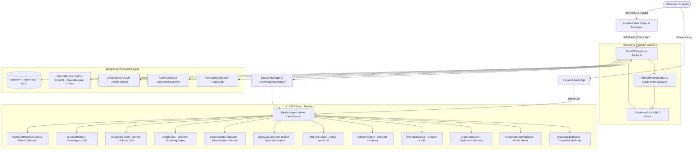

# 📊 GrapheinAI — Plateforme SaaS d'Intelligence Graphique Enterprise & Multimodale

[](https://www.python.org/downloads/release/python-3120/)
[](https://fastapi.tiangolo.com)
[](https://deepmind.google/technologies/gemini/)
[](https://opencv.org/)
[](https://github.com/facebookresearch/faiss)
[](https://supabase.com)
[](Dockerfile)
[]()
[]()

---

## 🌟 Présentation & Vision

**GrapheinAI** est une plateforme SaaS industrielle d'intelligence graphique multimodale conçue pour les entreprises, chercheurs, analystes financiers et décideurs. Elle automatise l'extraction, la validation, l'analyse, l'interprétation narrative et la synthèse décisionnelle à partir de tout type de visuels de données (histogrammes, courbes, camemberts, nuages de points, graphiques boursiers et planches multi-graphiques complexes).

### Vision Produit
Consolider l'alliance entre la **Vision par Ordinateur**, les **Grands Modèles Vision-Langage (VLM)** et l'**Évaluation Mathématique Déterministe** afin de garantir une précision absolue à zéro hallucination sur les calculs analytiques tout en offrant une expérience utilisateur fluide, collaborative et prête pour la production d'entreprise.

---

## ✨ Fonctionnalités Majeures

### 1. Ingestion & Vision Multimodale Hybride
- **Extraction Multimodale Double-Moteur** : Prétraitement géométrique OpenCV (seuillage adaptatif, contours, isolation des axes et textes) combiné à l'inférence sémantique du VLM Gemini Flash 2.5 / Pro.
- **Support Multi-Graphiques & Planches Complexes (`MultiChartPipelineAgent`)** : Détection hiérarchique automatique des sous-graphiques au sein d'une même planche de bord, découpage dynamique des régions d'intérêt et analyse individualisée.
- **Moteur de Fusion Croisée (`MultiChartFusion`)** : Synthèse unifiée croisant les métriques de multiples graphiques pour dégager des corrélations, des comparaisons inter-séries et des tendances consolidées.
- **Fallback ML Local Rapide** : Classifieur XGBoost / Scikit-Learn entraîné sur les caractéristiques géométriques pour classifier instantanément les types de graphiques sans coût API.

### 2. Précision Mathématique & Zéro-Hallucination
- **Calculateur Déterministe AST (`SafeCalculator`)** : Les questions de calcul arithmétique ou statistique (variations en %, sommes, ratios, écarts) sont traduites en formules et exécutées dans un interpréteur d'Arbre Syntaxique Abstrait Python isolé. Zéro risque d'erreur de calcul LLM et élimination totale des risques d'injection de code (`eval` banni).
- **Routage Intelligent des Requêtes (`QuestionRouter`)** : Analyse sémantique locale de l'intention (Lookup de valeur, Calcul arithmétique, Tendance statistique, Analyse libre) permettant de router directement vers l'AST ou le moteur vectoriel, économisant jusqu'à 75% des requêtes VLM.
- **Détection Automatisée d'Anomalies (`AnomalyDetector`)** : Détection des ruptures de tendance, valeurs extrêmes et anomalies statistiques via les méthodes Z-Score et Écart Interquartile (IQR).

### 3. Validation Humaine & Copilote Conversationnel
- **Grille Interactive Human-in-the-Loop (HITL DataGrid)** : Tableau éditable dynamique (style Notion / Airtable) permettant à l'analyste de modifier, ajouter ou corriger les étiquettes, valeurs et seuils de confiance avant de lancer les raisonnements.
- **Gestionnaire de Sessions & Historique Multi-Tours (`ConversationManager` & `SessionManager`)** : Copilote interactif conservant le contexte de l'analyse au fil des échanges sans avoir à ré-extraire l'image à chaque question.
- **Moteur d'Explicabilité & Traçabilité XAI (`ExplainabilityEngine`)** : Génération d'une fiche de traçabilité complète comprenant 10 indicateurs (boîtes englobantes sources, formule AST exacte, score de confiance, réconciliation OCR vs VLM).

### 4. Synthèse Décisionnelle & Personnalisation Métier
- **Interpréteur Scientifique Narratif (`GraphInterpreter`)** : Production automatique d'un rapport structuré en 4 sections d'élite : Cadrage stratégique, Tendances & métriques clés, Risques & anomalies identifiés, Opportunités de croissance.
- **Copilote Personnalisé par Profil Métier (`RecommendationEngine`)** : Adaptation automatique du vocabulaire, des indicateurs clés et des recommandations selon la fonction (Directeur Financier, Data Analyst, Médecin, Ingénieur) et le secteur d'activité (Finance, Santé, Industrie, Tech, Énergie).
- **Génération de Rapports PDF & Exports Multi-Formats** : Moteur ReportLab produisant des rapports vectoriels téléchargeables intégrant l'image, les données tabulaires, les analyses narratives et la traçabilité XAI, ainsi que des exports tableurs Excel (.xlsx).

### 5. Collaboration, Multi-Tenant & Entreprise
- **Authentification & Isolation Multi-Tenant (Supabase RLS)** : Authentification JWT, gestion d'espaces de travail partagés (`workspaces`), rôles RBAC stricts (Admin, Analyst, Viewer) et politiques PostgreSQL Row Level Security.
- **Infrastructure Email Transactionnelle Multi-Fournisseurs (`EmailService`)** : Support interchangeable de Resend, Brevo, SMTP d'entreprise et MailDev (environnement de dev local) avec file d'attente asynchrone non-bloquante (`EmailQueue`).
- **Partage Sécurisé & Invitations d'Équipe** : Envoi d'invitations sécurisées par jetons chiffrés, génération de liens de partage temporaires et fils de commentaires collaboratifs par session d'analyse.
- **Console d'Administration & Monitoring SRE** : Tableau de bord de supervision des ressources (CPU, RAM, latences P95/P99), métriques d'appels Gemini, gestion des clés API et journaux d'audit structurés.
- **Bilinguisme Natif FR / EN (`LanguageManager`)** : Support intégral Français / Anglais sur toute l'application (interface SPA, réponses de l'IA, rapports PDF et emails).

---

## 🏗️ Architecture Système & Composants



---

## 🛠️ Stack Technologique Complète

| Domaine | Technologies & Bibliothèques | Rôle & Particularités |
| :--- | :--- | :--- |
| **Backend & API** | **FastAPI** 0.110.0, **Uvicorn**, **Pydantic v2** | API REST asynchrone haute performance, typage strict, documentation Swagger/OpenAPI native. |
| **Frontend Web** | **Vanilla HTML5, CSS3, ES6 JavaScript** | SPA ultra-légère (< 200 KB), Design System Enterprise, animations CSS, ThemeManager (Dark/Light). |
| **Interface Alternative** | **Streamlit** 1.32.0+, **Streamlit-AgGrid** | Dashboard interactif avec grille HITL éditable pour les data scientists et démonstrations. |
| **VLM & Vision IA** | **Google Gemini 2.5 Flash & Pro**, **Google GenAI** | Inférence multimodale haute vitesse, analyse sémantique visuelle, fallback résilient multi-modèles. |
| **Vision par Ordinateur** | **OpenCV (`opencv-python-headless`)**, **Pillow** | Segmentation géométrique des contours, détection des boîtes englobantes de textes et des axes. |
| **Évaluation Sécurisée** | **Python `ast` (Abstract Syntax Tree)** | Calculs arithmétiques déterministes à zéro hallucination et protection stricte contre les injections. |
| **RAG & Recherche Vectorielle** | **FAISS CPU**, **Sentence-Transformers** (`all-MiniLM-L6-v2`) | Indexation et recherche vectorielle sous-milliseconde pour l'enrichissement contextuel du prompt. |
| **Machine Learning Local** | **Scikit-Learn**, **XGBoost** | Classification rapide de complexité et de type de graphique à partir des caractéristiques d'image. |
| **Base de Données & Auth** | **Supabase PostgreSQL**, **Supabase Auth (JWT)** | Isolation multi-tenant étanche avec Row Level Security (RLS) et gestion des rôles RBAC. |
| **Emailing d'Entreprise** | **Resend**, **Brevo**, **SMTP**, **MailDev** | Distribution d'emails transactionnels, invitations d'équipe et alertes avec file d'attente asynchrone. |
| **Génération Documentaire** | **ReportLab**, **OpenPyXL**, **XlsxWriter** | Rapports d'analyse vectoriels PDF multi-pages haute résolution et tableurs Excel structurés. |
| **Résilience & Cache SRE** | **DiskCache**, **Tenacity**, **Hachage Perceptuel (`imagehash`)** | Cache double niveau (SHA256 + imagehash), régulation de quota Leaky-Bucket et retry exponentiel. |
| **Internationalisation** | **LanguageManager**, **`langdetect`**, dictionnaire JSON | Bilinguisme natif FR/EN pour l'interface, les prompts, les réponses IA et les documents PDF. |
| **Sécurité & Qualité** | **PromptInjectionGuard**, **Pytest**, **Ruff**, **Black** | Protection anti-jailbreak, validation magic bytes, suite complète de 28 modules de tests (180+ tests). |

---

## 🔄 Pipelines Clés de l'Application

### 1. Pipeline d'Extraction & Vision Hybride
L'image du graphique est traitée conjointement :
1. **OpenCV OCR Engine** : Détection des contours et calcul des coordonnées de boîtes englobantes `[x, y, w, h]` (axes, légendes, libellés).
2. **Gemini Vision Service** : Inférence sémantique VLM structurée via Pydantic (`FullChartExtraction`), extrayant type, titre, axes, séries et points de données (`ExtractedDataPoint`).
3. **ChartIntelligenceEngine** : Réconciliation géométrique et sémantique croisant les boîtes englobantes réelles et les données textuelles pour fiabiliser la localisation spatiale.

### 2. Pipeline Multi-Graphiques & Fusion Croisée
Lorsqu'une planche contient plusieurs graphiques distincts :
1. **MultiChartDetector** : Analyse hiérarchique des contours d'image pour détecter les séparateurs et isoler chaque sous-graphique dans une région d'intérêt (ROI).
2. **MultiChartPipelineAgent** : Ingestion et extraction en parallèle de chaque sous-graphique.
3. **MultiChartFusion** : Corrélations multi-séries, détection des divergences et synthèse stratégique globale croisée.

### 3. Pipeline Calcul AST Déterministe (Zéro Hallucination)
Pour toute question impliquant des opérations mathématiques (ex: *"Quel est le taux de croissance entre 2021 et 2024 ?"*, *"Quelle est la part relative du segment B ?"*) :
1. La question est qualifiée par le `QuestionRouter`.
2. L'expression arithmétique est formalisée puis transmise au `SafeCalculator`.
3. L'arbre syntaxique (`ast.parse`) est validé sur une liste blanche stricte (opérateurs +, -, *, /, %, puissances, min, max, moyenne).
4. Le calcul est exécuté par le processeur Python natif avec une précision absolue, éliminant 100% des erreurs de calcul du VLM.

### 4. Pipeline Caching Intelligent & Éco-Conception SRE
Pour optimiser les quotas d'API et accélérer les temps de réponse :
1. **Double Clé de Cache** : Empreinte cryptographique SHA-256 du fichier et hachage perceptuel d'image (`imagehash`).
2. **Cache Hit Immédiat** : Si un graphique identique ou quasi-identique a déjà été analysé, les données structurées sont immédiatement restituées depuis le `ChartCacheManager` (< 50 ms).
3. **Question Routing Éco-Conçu** : Les questions de consultation directe ou de calcul sont résolues localement sans solliciter l'API Gemini distante, réduisant l'empreinte carbone et les coûts opérationnels jusqu'à 75%.
4. **Leaky Bucket Quota Manager** : Contrôle dynamique des requêtes par minute (RPM) et tokens par minute (TPM) pour prévenir les erreurs HTTP 429.

---

## 🖥️ Expérience Utilisateur & Interface Studio SaaS

L'interface web moderne (`src/app/static/index.html`) est articulée autour d'un parcours utilisateur fluide et d'un design system professionnel :

1. **Stepper Horizontal Guidé en 5 Étapes** :
   - **Étape 1 : Ingestion & Upload** : Zone drag & drop intuitive avec validation en temps réel du format et de l'intégrité de l'image.
   - **Étape 2 : Détection & Segmentation** : Visualisation des contours détectés et classification automatique du type de graphique.
   - **Étape 3 : Validation HITL (Human-in-the-Loop)** : Grille de données interactive permettant à l'analyste de modifier, valider ou enrichir les points de données extraits.
   - **Étape 4 : Interpréteur & Copilote IA** : Chat conversationnel multi-tours avec bascule automatique entre mode calcul AST, recherche vectorielle et analyse stratégique métier.
   - **Étape 5 : Exportation & Partage** : Téléchargement instantané du rapport PDF vectoriel officiel ReportLab ou de classeurs Excel, et partage d'analyse avec les collaborateurs.

2. **Modal de Configuration à 6 Volets** :
   - **Mon Profil** : Personnalisation de la fonction, de l'entreprise, du secteur d'activité et du niveau d'expertise pour adapter les analyses.
   - **Préférences** : Sélection de la langue (Français / Anglais) avec actualisation dynamique sans rechargement.
   - **Apparence** : Bascule instantanée entre Mode Sombre (Dark Mode) et Mode Clair (Light Mode) gérée par `ThemeManager.js`.
   - **Assistant IA** : Réglage du modèle cible (Gemini 2.5 Flash / Pro) et de la profondeur d'analyse.
   - **Notifications** : Configuration des alertes par email et résumés périodiques.
   - **Sécurité** : Gestion des clés API personnelles et renouvellement sécurisé de mot de passe.

3. **Console d'Administration & Supervision d'Équipe** :
   - Tableau de bord dédié aux administrateurs pour la gestion des utilisateurs (rôles RBAC), la surveillance des ressources serveur, l'audit des quotas de consommation et la consultation des logs d'erreurs.

---

## 🔌 Principaux Endpoints API REST

L'application expose une API REST complète documentée via Swagger (`/docs`) et ReDoc (`/redoc`) :

| Catégorie | Méthode & Route | Description |
| :--- | :--- | :--- |
| **Système & SRE** | `GET /health`, `GET /api/status` | Vérification de la disponibilité du serveur et métriques de santé des 8 composants core. |
| **Métriques IA** | `GET /api/gemini/metrics` | Statistiques de requêtes Gemini, ratio de cache hit, latences et consommation de tokens. |
| **Authentification**| `POST /api/auth/login`, `POST /api/auth/signup` | Connexion, inscription et émission des jetons JWT sécurisés. |
| **Profil Utilisateur**| `GET /api/auth/me`, `PUT /api/user/profile` | Consultation et mise à jour du profil métier et des préférences sectorielles. |
| **Ingestion & VLM** | `POST /api/extract` | Téléversement d'image, détection OCR et extraction structurée des données du graphique. |
| **Analyse & Calcul** | `POST /api/analyze` | Pose de question analytique avec routage automatique vers AST SafeCalculator ou Gemini. |
| **Sessions d'Analyse**| `GET /api/session/active`, `POST /api/session/new` | Gestion de l'état de session d'analyse courante et historique des sessions sauvegardées. |
| **Explicabilité XAI**| `GET /api/explain/{session_id}` | Récupération de la fiche complète de traçabilité XAI pour une session donnée. |
| **Exportation PDF** | `POST /api/report/pdf` | Génération et téléchargement direct du rapport PDF vectoriel ReportLab de l'analyse. |
| **Workspaces** | `GET /api/workspaces`, `POST /api/workspaces` | Création et gestion des espaces de travail collaboratifs multi-utilisateurs. |
| **Invitations** | `POST /api/invitations/send`, `POST /api/invitations/accept` | Envoi et validation d'invitations sécurisées par email pour rejoindre un espace. |
| **Partage Sécurisé**| `POST /api/share/link/create`, `GET /api/share/link/{token}` | Création et consultation de liens publics ou restreints pour partager une analyse. |
| **Console Admin** | `GET /api/admin/users`, `GET /api/admin/metrics` | Gestion des comptes utilisateurs, quotas et supervision d'infrastructure (rôle Admin). |
| **Internationalisation**| `GET /i18n/{lang}.json` | Téléchargement des dictionnaires de localisation FR / EN. |

---

## ⚙️ Installation & Configuration Local

### 1. Clonage & Environnement Virtuel

```bash
git clone https://github.com/your-org/GrapheinAI.git
cd GrapheinAI

python -m venv venv
# Linux / macOS :
source venv/bin/activate
# Windows :
venv\Scripts\activate

pip install -r requirements.txt
```

### 2. Variables d'Environnement (`.env`)

Créer un fichier `.env` à la racine à partir du modèle `.env.example` :

```ini
# Core Configuration
ENVIRONMENT=production
PORT=8088
LOG_LEVEL=INFO

# Google Gemini API
GEMINI_API_KEY=your_gemini_api_key_here
GEMINI_MODEL=gemini-2.5-flash

# Supabase Database & Auth (Optionnel pour mode standalone)
SUPABASE_URL=https://your-supabase-project.supabase.co
SUPABASE_ANON_KEY=your_supabase_anon_key
SUPABASE_SERVICE_ROLE_KEY=your_supabase_service_role_key

# Email Provider (Resend / Brevo / SMTP / MailDev)
EMAIL_PROVIDER=resend
RESEND_API_KEY=your_resend_api_key
DEFAULT_FROM_EMAIL=notifications@graphein.ai
```

---

## 🚀 Déploiement

### Déploiement FastAPI (Backend REST & SPA Frontend)
```bash
python -m uvicorn app:app --host 0.0.0.0 --port 8088
```
L'interface web est alors accessible sur `http://localhost:8088` et la documentation interactive sur `http://localhost:8088/docs`.

### Déploiement Streamlit (UI Data Science Alternative)
```bash
streamlit run app.py
```

### Déploiement Docker & Docker-Compose
```bash
docker-compose up -d --build
```

---

## 📊 Structure du Projet

```
GrapheinAI/
├── app.py                         # Point d'entrée principal (FastAPI ASGI / Streamlit)
├── requirements.txt               # Dépendances de production Python
├── pyproject.toml                 # Configuration Pytest, Ruff, Black
├── Dockerfile                     # Image Docker multi-stage optimisée
├── docker-compose.yml             # Orchestration de conteneurs
├── render.yaml                    # Configuration Blueprint de déploiement cloud
├── supabase/
│   └── schema.sql                 # Schéma PostgreSQL & politiques RLS multi-tenant
├── src/
│   ├── agents/                    # Moteurs et agents d'IA spécialisés
│   │   ├── pipeline_agent.py          # Orchestrateur Master (PipelineAgent)
│   │   ├── reasoning_agent.py         # Agent de vision VLM Gemini 2.5
│   │   ├── safe_calculator.py         # Calculateur mathématique déterministe AST
│   │   ├── multi_chart_pipeline.py    # Pipeline pour planches multi-graphiques
│   │   ├── multi_chart_fusion.py      # Moteur de fusion croisée multi-graphiques
│   │   ├── graph_interpreter.py       # Synthèse narrative scientifique
│   │   ├── recommendation_engine.py   # Copilote de recommandations par profil métier
│   │   ├── explainability_engine.py   # Moteur de traçabilité et explicabilité XAI
│   │   ├── conversation_manager.py    # Gestion des contextes de chat multi-tours
│   │   ├── intent_classifier.py       # Classification de l'intention des questions
│   │   ├── classifier_agent.py        # Classification locale de complexité
│   │   ├── retrieval_agent.py         # Agent RAG vectoriel FAISS
│   │   ├── validation_agent.py        # Calcul du score de confiance d'extraction
│   │   └── insight_agent.py           # Extraction automatique d'insights clés
│   ├── services/                  # Services d'infrastructure et d'intégration
│   │   ├── gemini/                    # Sous-système Gemini Enterprise
│   │   │   ├── service.py                 # Service principal GeminiService
│   │   │   ├── cache.py                   # ChartCacheManager (SHA256 & perceptual)
│   │   │   ├── router.py                  # QuestionRouter (Lookup, AST, RAG, VLM)
│   │   │   ├── quota.py                   # GeminiQuotaManager (Leaky Bucket RPM/TPM)
│   │   │   └── retry.py                   # ExponentialBackoffRetry avec jitter
│   │   ├── supabase_service.py        # Client Supabase PostgreSQL & Auth RLS
│   │   ├── email_service.py           # Infrastructure email multi-fournisseurs
│   │   ├── session_manager.py         # Gestionnaire de sessions et persistance
│   │   ├── admin_service.py           # Services d'administration et gestion utilisateurs
│   │   ├── collaboration_service.py   # Espaces de travail et partage collaboratif
│   │   ├── observability_service.py   # Métriques système et surveillance SRE
│   │   └── task_queue.py              # File de tâches asynchrone non-bloquante
│   ├── utils/                     # Algorithmes de traitement et utilitaires
│   │   ├── ocr_engine.py              # Prétraitement et détection de boîtes OpenCV
│   │   ├── chart_intelligence_engine.py# Réconciliation géométrie OpenCV et vision VLM
│   │   ├── multi_chart_detector.py    # Détection et découpage des multi-graphiques
│   │   ├── anomaly_detector.py        # Détecteur d'anomalies statistiques (Z-score, IQR)
│   │   ├── pdf_generator.py           # Moteur de génération de rapports PDF ReportLab
│   │   ├── security_guard.py          # PromptInjectionGuard et vérification magic bytes
│   │   ├── faiss_optimizer.py         # Gestion et optimisation de l'index FAISS
│   │   └── structured_logger.py       # Journalisation structurée JSON avec Loguru
│   ├── app/                       # Applications web et API
│   │   ├── api.py                     # Routeur FastAPI et contrôleurs REST
│   │   ├── streamlit_app.py           # Application Streamlit interactive
│   │   └── static/                    # Interface Web SPA Enterprise
│   │       ├── index.html                 # Page SPA complète (Stepper, HITL, Chat, Modals)
│   │       ├── css/design_system.css      # Design system moderne et tokens graphiques
│   │       └── js/theme_manager.js        # Gestionnaire de thème dynamique (Dark/Light)
│   ├── models/                    # Modèles de données Pydantic stricts
│   │   ├── chart.py                   # Modèles d'extraction de graphiques
│   │   ├── multi_chart.py             # Modèles de planches multi-graphiques
│   │   ├── session.py                 # Modèles de sessions et historiques
│   │   ├── user.py                    # Profils utilisateurs et RBAC
│   │   └── workspace.py               # Espaces de travail collaboratifs
│   └── i18n/                      # Internationalisation native
│       ├── language_manager.py        # Détection et commutation linguistique
│       └── translations/              # Dictionnaires de traduction fr.json et en.json
├── archive/
│   └── scripts/                   # Scripts utilitaires historiques archivés
├── scripts/
│   └── backup_manager.py          # Gestionnaire de sauvegardes automatiques SRE
├── docs/                          # Guides techniques et rapports d'architecture
└── tests/                         # Suite de 28 modules de tests automatisés Pytest
```

---

## 🔒 Authentification, Collaboration & Sécurité

- **Supabase Auth & RLS** : Authentification par jetons JWT, gestion des espaces de travail partagés (`workspaces`), rôles RBAC (Admin, Analyst, Viewer) et politiques PostgreSQL RLS garantissant une stricte étanchéité des données multi-tenant.
- **PromptInjectionGuard & Sécurité Fichiers** : Filtrage anti-jailbreak, nettoyage des entrées utilisateurs et validation des en-têtes "magic bytes" des fichiers téléversés pour bloquer toute injection ou fichier malveillant.
- **Cache Hybride Intelligent** : Réutilisation instantanée des analyses précédentes via hachage perceptuel (`imagehash`) et SHA-256 pour réduire l'exposition aux API externes et minimiser la latence.
- **Zéro Hallucination & AST Isolé** : Évaluation mathématique déterministe dans un environnement AST protégé interdisant toute instruction système arbitraire.

---

## ❓ FAQ & Résolution de Problèmes

**Q : L'application peut-elle fonctionner sans instance Supabase ?**  
R : Oui, l'application dispose d'un mode fallback standalone avec authentification et sessions locales en mémoire vive.

**Q : Comment sont évitées les erreurs de quota Gemini (HTTP 429) ?**  
R : Le `GeminiQuotaManager` régule les requêtes via un algorithme Leaky-Bucket, combiné à un `ExponentialBackoffRetry` avec gigue temporelle (jitter) et au routage direct des calculs vers l'AST.

**Q : Comment l'analyste peut-il corriger une valeur mal lue sur un graphique de faible qualité ?**  
R : Dès l'étape 3 du workflow, la grille de données interactive (HITL DataGrid) permet à l'utilisateur de modifier directement les étiquettes et valeurs numériques. Tous les calculs et synthèses ultérieurs se basent sur ces données validées.

---

## 🗺️ Roadmap & Améliorations Futures

- [x] Support multi-graphiques et fusion de planches d'analyse (`MultiChartPipelineAgent`).
- [x] Authentification Supabase RLS et invitations d'équipe sécurisées.
- [x] Exportation PDF vectoriel ReportLab et tableurs Excel multi-feuilles.
- [x] Sous-système Gemini avec cache SHA256, QuestionRouter et régulation de quota.
- [x] Internationalisation intégrale FR / EN sur toute la plateforme.
- [ ] Connecteur direct bases de données d'entreprise (PostgreSQL, Snowflake, BigQuery).
- [ ] Support des visualisations cartographiques géospatiales et graphiques 3D volumétriques.

---

## 📄 Licence

Copyright © 2026 **GrapheinAI Team**. Tous droits réservés.  
Proprietary SaaS Enterprise Application.
