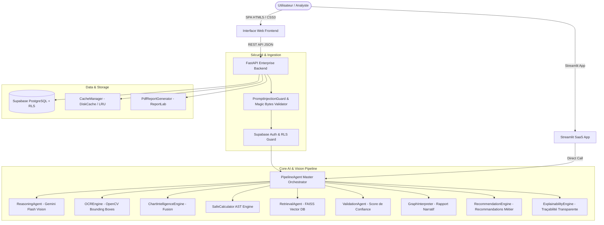

# 📊 GrapheinAI — Plateforme SaaS d'Intelligence Graphique Enterprise & Multimodale

[](https://www.python.org/downloads/release/python-3120/)
[](https://fastapi.tiangolo.com)
[](https://deepmind.google/technologies/gemini/)
[](https://opencv.org/)
[](https://github.com/facebookresearch/faiss)
[](https://supabase.com)
[](Dockerfile)
[]()
[]()

---

## 🌟 Présentation & Vision

**GrapheinAI** est une plateforme SaaS industrielle d'intelligence graphique multimodale conçue pour les entreprises, chercheurs, analystes financiers et décideurs. Elle automatise l'extraction, la validation, l'analyse, l'interprétation narrative et la synthèse décisionnelle à partir de tout type de visuels de données (histogrammes, courbes, camemberts, nuages de points et planches multi-graphiques complexifiées).

### Vision Produit
Consolider l'alliance entre la **Vision par Ordinateur**, les **Grands Modèles Vision-Langage (VLM)** et l'**Évaluation Mathématique Déterministe** afin de garantir une précision absolue à zéro hallucination sur les calculs analytiques tout en offrant une expérience utilisateur fluide, collaborative et prête pour la production d'entreprise.

---

## ✨ Fonctionnalités Majeures

- **🔍 Extraction Multimodale Hybride** : Segmentation OpenCV des contours géométriques et analyse sémantique Gemini Vision.
- **🎛️ Human-in-the-Loop (HITL) Data Grid** : Édition et validation interactive des valeurs extraites avant calculs.
- **🧮 Calculateur Sécurisé AST (`SafeCalculator`)** : Analyseur d'Arbre Syntaxique Abstrait Python zéro-hallucination.
- **⚡ Moteur RAG FAISS & Classifier d'Intention** : Routage dynamique des questions et recherche vectorielle contextuelle sous-milliseconde.
- **📜 Synthèse Narrativisée & Copilote Métier** : Génération de synthèses exécutives et de recommandations stratégiques multi-profils (Finance, Santé, Industrie, Tech).
- **📄 Exports Officiels PDF & Excel** : Rapport ReportLab vectoriel multi-pages et tableurs structurés openpyxl/xlsxwriter.
- **👥 Authentification Multi-Tenant & Workspaces** : Supabase Auth JWT, rôles RBAC et règles PostgreSQL Row Level Security (RLS).
- **🌐 Multilingue Native (FR / EN)** : Support intégral du Français et de l'Anglais avec détection automatique.
- **📧 Notifications & Invitations par Email** : Intégration Resend / SMTP pour la collaboration d'équipe.

---

## 🏗️ Architecture Système & Composants



---

## 🛠️ Stack Technologique

- **Langage** : Python 3.12+
- **Backend API** : FastAPI, Uvicorn, Pydantic v2
- **Interface UI SaaS** : Streamlit (App interactive) & Frontend SPA Vanilla CSS
- **Vision & IA** : Google Gemini Flash 1.5/3.5 Vision, OpenCV (Computer Vision), Scikit-Learn, XGBoost
- **RAG & Vector Search** : FAISS CPU, Sentence-Transformers
- **Base de Données & Auth** : Supabase PostgreSQL, Supabase Auth (JWT), Row Level Security (RLS)
- **Emailing** : Resend API, Python SMTPLib
- **Génération de Documents** : ReportLab (PDF Vectoriel), OpenPyXL, XlsxWriter
- **Cache & Performance** : DiskCache, Tenacity (Retry exponential backoff)
- **Conteneurisation & DevOps** : Docker, Docker-Compose, Hetzner Cloud Deployment Ready

---

## 🔄 Pipelines IA, Vision, RAG & AST

### 1. Pipeline Vision & Extraction Hybride
L'image du graphique est analysée simultanément par deux moteurs :
1. **OpenCV OCR Engine** : Détection des contours, découpage des boîtes englobantes `[x, y, w, h]` pour isoler axes, graduations et légendes.
2. **Gemini Vision Service** : Inférence VLM produisant un objet Pydantic strict (`ChartExtraction`) comportant le titre, le type de graphique, les unités, les axes et la liste structurée des points de données (`ExtractedDataPoint`).

### 2. Pipeline AST SafeCalculator (Zéro Hallucination)
Pour répondre aux questions de calcul (ex: *"Quelle est la variation en % entre 2020 et 2024 ?"*), la question est traduite en expression mathématique puis évaluée par un analyseur d'arbre syntaxique abstrait (`ast.parse`). Seuls les opérateurs arithmétiques purs et fonctions statistiques sûres sont autorisés. Tout appel système ou tentative d'injection est bloqué.

### 3. Pipeline RAG Vectoriel FAISS
Les éléments contextuels et données historiques sont vectorisés via `sentence-transformers` et indexés dans une base vectorielle FAISS sous-milliseconde pour enrichir le prompt de raisonnement avec un contexte métier pertinent.

---

## ⚙️ Installation & Configuration Local

### 1. Clonage & Environnement Virtuel

```bash
git clone https://github.com/your-org/GrapheinAI.git
cd GrapheinAI

python -m venv venv
# Linux / macOS :
source venv/bin/activate
# Windows :
venv\Scripts\activate

pip install -r requirements.txt
```

### 2. Variables d'Environnement (`.env`)

Créer un fichier `.env` à la racine à partir du modèle `.env.example` :

```ini
# Core Configuration
ENVIRONMENT=production
PORT=8088
LOG_LEVEL=INFO

# Google Gemini API
GEMINI_API_KEY=your_gemini_api_key_here
GEMINI_MODEL=gemini-1.5-flash

# Supabase Database & Auth (Optionnel pour mode standalone)
SUPABASE_URL=https://your-supabase-project.supabase.co
SUPABASE_ANON_KEY=your_supabase_anon_key
SUPABASE_SERVICE_ROLE_KEY=your_supabase_service_role_key

# Email Provider (Resend)
RESEND_API_KEY=your_resend_api_key
DEFAULT_FROM_EMAIL=notifications@graphein.ai
```

---

## 🚀 Déploiement

### Déploiement FastAPI (Backend REST)
```bash
python -m uvicorn app:app --host 0.0.0.0 --port 8088
```

### Déploiement Streamlit (UI SaaS)
```bash
streamlit run app.py
```

### Déploiement Docker & Docker-Compose
```bash
docker-compose up -d --build
```

### Déploiement Hetzner Cloud
Le projet est optimisé pour un déploiement direct via Docker sur serveur virtuel Hetzner Cloud (Ubuntu 22.04 / 24.04 LTS) derrière un reverse-proxy Nginx avec certificat Let's Encrypt SSL.

---

## 📊 Structure du Projet

```
GrapheinAI/
├── app.py                      # Launcher racine (FastAPI ASGI / Streamlit)
├── requirements.txt            # Dépendances Python de production
├── pyproject.toml              # Pytest, Ruff, Black configuration
├── Dockerfile                  # Docker container build script
├── docker-compose.yml          # Container orchestration
├── supabase/
│   └── schema.sql              # Schéma PostgreSQL & politiques RLS
├── src/
│   ├── agents/                 # Pipeline d'agents IA (14 modules)
│   ├── app/                    # Applications FastAPI & Streamlit
│   ├── models/                 # Modèles Pydantic / DTOs
│   ├── services/               # Services Supabase, Gemini, Email, Cache
│   ├── utils/                  # OCR, FAISS RAG, PDF Generator, Security
│   └── i18n/                   # Internationalisation FR / EN
├── archive/
│   └── scripts/                # Scripts de démo vidéo archivés
├── scripts/
│   └── backup_manager.py       # Script de sauvegarde SRE
├── docs/                       # Rapports & guides techniques
└── tests/                      # Suite de tests automatisée Pytest
```

---

## 🔒 Authentification, Collaboration & Sécurité

- **Supabase Auth & RLS** : Authentification par jetons JWT, gestion des espaces de travail partagés (`workspaces`), rôles RBAC (Admin, Analyst, Viewer) et politiques RLS strictes.
- **PromptInjectionGuard** : Filtrage anti-jailbreak, nettoyage HTML/script et validation des en-têtes "magic bytes" des fichiers téléversés (PNG, JPEG, WEBP, PDF).
- **Cache Hybride Intelligent** : Re-réutilisation des résultats d'extractions identiques via hachage perceptuel (`imagehash`) et DiskCache pour optimiser les quotas API Gemini.

---

## ❓ FAQ & Résolution de Problèmes

**Q : L'application peut-elle fonctionner sans Supabase ?**  
R : Oui, l'application dispose d'un mode fallback standalone avec authentification et sessions locales.

**Q : Comment sont gérées les erreurs de parsing d'image ?**  
R : Le `ValidationAgent` évalue un score de confiance. Si la confiance est faible, l'utilisateur est invité à vérifier la grille d'édition HITL.

---

## 🗺️ Roadmap & Améliorations Futures

- [x] Support multi-graphiques et fusion de planches d'analyse.
- [x] Authentification Supabase RLS et invitations d'équipe.
- [x] Exportation PDF vectoriel ReportLab et Excel multi-feuilles.
- [ ] Support des graphiques 3D complexes et cartes choroplèthes.
- [ ] Connecteur direct bases SQL d'entreprise (PostgreSQL, Snowflake).

---

## 📄 Licence

Copyright © 2026 **GrapheinAI Team**. Tous droits réservés.  
Proprietary SaaS Enterprise Application.
