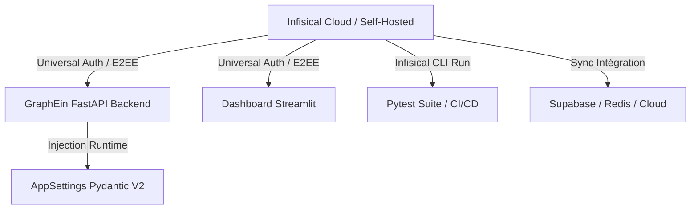

# Guide Complet de Gestion des Secrets avec Infisical — LumiChart

## 1. Vue d'Ensemble & Architecture Zero-Trust

[Infisical](https://infisical.com/) est la plateforme SecretOps d'entreprise open-source retenue par **LumiChart** pour centraliser, chiffrer de bout en bout (E2EE), versionner et injecter automatiquement les secrets et variables d'environnement sur l'ensemble du cycle de vie :

- **Développement Local** : Injection en mémoire via le CLI Infisical (`infisical run`) ou fallback transparent sur `.env`.
- **CI/CD (GitHub Actions)** : Injection sans fichier disque via Universal Auth (Machine Identity).
- **Conteneurs & Production** : Synchronisation temps réel avec le SDK Python `infisical_sdk` ou injection orchestrée (Docker / Kubernetes / Cloud Run / VPS).



---

## 2. Installation du CLI Infisical

### Sous Windows
Via **Winget** (recommandé) :
```powershell
winget install Infisical.InfisicalCLI
```
Ou via **Scoop** :
```powershell
scoop bucket add infisical https://github.com/Infisical/scoop-infisical.git
scoop install infisical
```
Ou via **Chocolatey** :
```powershell
choco install infisical
```

### Sous Linux / WSL / Ubuntu
```bash
curl -1sLf 'https://dl.cloudsmith.io/public/infisical/infisical-cli/setup.deb.sh' | sudo -E bash
sudo apt-get update && sudo apt-get install -y infisical
```

### Sous macOS
```bash
brew install infisical/get-cli/infisical
```

---

## 3. Configuration Initiale du Projet

### Étape 1 : Authentification Développeur
```bash
# Ouvre votre navigateur pour autoriser votre terminal
make infisical-login
# Ou directement :
infisical login
```

### Étape 2 : Liaison du Répertoire Local
À la racine de `LumiChart/` :
```bash
make infisical-init
# Ou directement :
infisical init
```
Sélectionnez votre organisation et le projet **graphein-ai**. Le fichier local [.infisical.json](file:///c:/Users/chris/Desktop/LumiChart/.infisical.json) sera automatiquement configuré.

---

## 4. Utilisation au Quotidien (Commandes Makefile)

| Commande | Action |
| :--- | :--- |
| `make dev-infisical` | Lance l'API FastAPI (`http://localhost:8088`) avec les secrets injectés depuis Infisical (`env=dev`). |
| `make ui-infisical` | Lance l'UI Streamlit (`http://localhost:8501`) avec les secrets injectés. |
| `make test-infisical` | Exécute la suite de tests `pytest` avec les secrets de l'environnement `test`. |
| `make secrets-status` | Diagnostic de connexion et validation des identifiants Infisical. |
| `make secrets-audit` | Vérifie la conformité et détecte les clés manquantes par rapport à `.env.example`. |
| `make secrets-pull` | Télécharge ponctuellement les secrets Infisical vers `.env` (pour outils legacy). |

---

## 5. Intégration dans le Code Source Python (SDK Infisical)

LumiChart intègre le client officiel [`InfisicalSDKClient`](file:///c:/Users/chris/Desktop/LumiChart/src/config/infisical_client.py) directement dans [AppSettings](file:///c:/Users/chris/Desktop/LumiChart/src/config/settings.py).

### Priorité de Résolution des Paramètres (Pydantic Settings V2) :
1. Arguments explicites d'initialisation (`AppSettings(gemini_api_key=...)`)
2. **Secrets Infisical** (si `INFISICAL_ENABLED=true` ou Machine Identity présente)
3. Variables d'environnement système (`os.environ`)
4. Fichier `.env` local
5. Valeurs par défaut sécurisées

### Variables d'Environnement Infisical :
```ini
# Active la synchronisation SDK
INFISICAL_ENABLED=true

# Machine Identity (Universal Auth) - Recommandé en Production & CI
INFISICAL_CLIENT_ID=votre_machine_identity_client_id
INFISICAL_CLIENT_SECRET=votre_machine_identity_client_secret

# Projet & Environnement
INFISICAL_PROJECT_ID=votre_project_id
INFISICAL_ENVIRONMENT=dev
INFISICAL_SECRET_PATH=/
INFISICAL_SITE_URL=https://app.infisical.com
```

---

## 6. Déploiement Production & CI/CD (Universal Auth)

### Création d'une Machine Identity dans Infisical :
1. Rendez-vous dans **Project Settings** > **Access Control** > **Machine Identities**.
2. Créez une nouvelle identité : `graphein-ci-cd` ou `graphein-prod-backend`.
3. Attribuez le rôle approprié (`Read Only` pour `prod` ou `test`).
4. Récupérez le **Client ID** et le **Client Secret**.

### Configuration GitHub Actions :
Dans les secrets de votre dépôt GitHub (`Settings > Secrets and variables > Actions`) :
- `INFISICAL_CLIENT_ID`
- `INFISICAL_CLIENT_SECRET`
- `INFISICAL_PROJECT_ID`

Le workflow `.github/workflows/ci_cd.yml` injectera alors automatiquement les secrets pour la suite de tests et les builds de conteneurs.

---

## 7. Inventaire des Secrets Critiques de LumiChart

| Clé | Usage | Criticité |
| :--- | :--- | :--- |
| `GEMINI_API_KEY` | Inférence multimodale vision Gemini 2.5 Flash | **Maximale** |
| `JWT_SECRET_KEY` | Signature cryptographique des tokens d'invitation | **Maximale** |
| `SUPABASE_URL` | Instance Supabase PostgreSQL | **Élevée** |
| `SUPABASE_KEY` | Clé publique Anon (RLS actif) | **Élevée** |
| `SUPABASE_SERVICE_ROLE_KEY` | Administration BDD & migrations backend | **Critique** |
| `RESEND_API_KEY` / `BREVO_API_KEY` | Fournisseur d'emailing transactionnel | **Moyenne** |
| `CINETPAY_API_KEY` & `SECRET_KEY` | Passerelle Mobile Money (UEMOA) | **Critique** |
| `REDIS_URL` | Cache et broker de tâches asynchrones | **Moyenne** |
| `SENTRY_DSN` | Observabilité et remontée des erreurs SRE | **Basse** |

---

## 8. Procédure d'Urgence & Rotation de Clés

1. **Révocation** immédiate de la clé compromise dans le tableau de bord du fournisseur (ex: Google AI Studio, Supabase).
2. **Mise à jour dans Infisical** :
   ```bash
   infisical secrets set GEMINI_API_KEY="nouvelle_cle_securisee" --env=prod
   ```
3. **Propagation instantanée** : Les conteneurs ou workers rechargeant leurs paramètres via Infisical ou redémarrés prendront immédiatement en compte la nouvelle valeur sans rebuild d'image.
